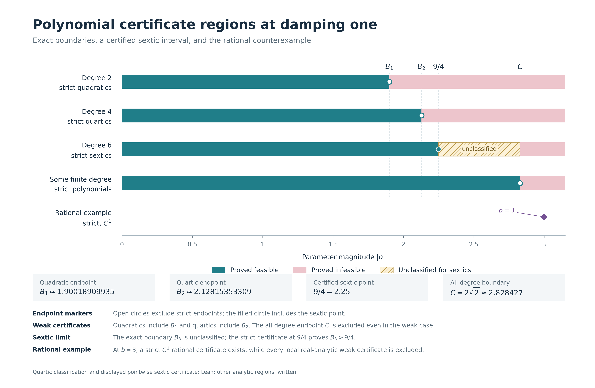

# quartic-lyapunov

Exact polynomial Lyapunov boundaries for a planar homogeneous cubic family.

For $R=x^2+y^2$, consider

```math
f_b(x,y)=(-R+b(x^2-y^2))(x,y)+R(-y,x),\qquad b\in\mathbb R.
```

Positive definite real homogeneous quartics with strictly negative Lie
derivative exist exactly for $|b|<B$; those with nonpositive Lie derivative
exist exactly for $|b|\le B$. Here $B\approx2.1281535330886186$ and $B^2$
is the unique root above one of

```math
16u^6-92u^5+125u^4-134u^3-103u^2-200u+100=0.
```

At $b=B$, every quartic with nonpositive Lie derivative is a nonnegative
multiple of one explicit positive quartic, even without assuming positivity.
Its negative derivative is a cubic square with three distinct real projective
zero lines. The theorem permits all five real coefficients and uses the
actual derivative along the field.

The Lean contract also contains a strict integer quartic at $b=2$ where no
positive weak quadratic exists, and a strict integer sextic at $b=9/4$ where
neither a positive weak quadratic nor a positive weak quartic exists. The
[verification record](VERIFICATION.md) specifies the exact release checks.



The figure includes written extensions beyond the Lean contract. For positive
damping $a$, replacing $-R$ by $-aR$ gives the exact unrestricted-degree
criterion

```math
|b|<(1+a^{2/3})^{3/2}.
```

This criterion is equivalent to existence of a positive definite homogeneous
polynomial of positive degree with strict or weak derivative, or a local
real-analytic weak Lyapunov function. The all-degree proof, explicit degree bound,
all-damping quadratic classification and rational certificate at $b=3$
remain written supplements.

- [Quartic proof](Proof.md), [endpoint certificate](docs/Endpoint.md) and
  [dual obstruction](docs/Dual.md).
- [Quartic example at two](docs/Applications.md) and
  [sextic separation at nine-fourths](docs/SexticSeparation.md).
- [Fixed-degree intervals](docs/Extensions.md),
  [all-degree classification](docs/AllDegreeClassification.md) and
  [quantitative degree bound](docs/QuantitativeDegreeBound.md).
- [Quadratic boundary for every damping](docs/QuadraticBoundary.md) and
  [integer field with no analytic certificate](docs/IntegerCounterexample.md).
- [Formal architecture](IMPLEMENTATION.md), [exact replays](evidence/README.md),
  [sources](docs/Sources.md) and [disclosure](Disclosure.md).

```sh
lake build
python scripts/verify_evidence.py
```

Lean and Mathlib revisions are pinned in [lean-toolchain](lean-toolchain),
[lakefile.toml](lakefile.toml) and [lake-manifest.json](lake-manifest.json).
Python replay dependencies are listed in [requirements.txt](requirements.txt).
